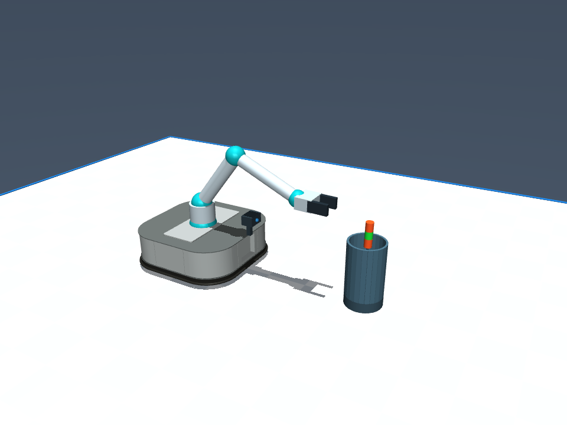
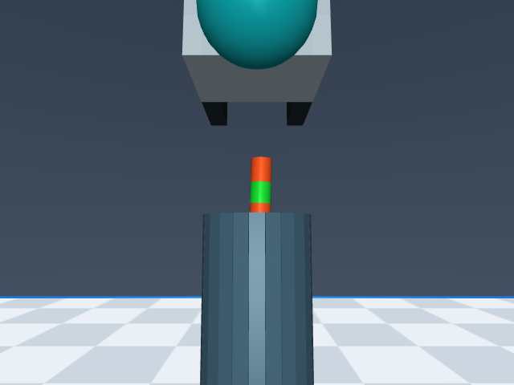

# D07 장면 구성표 — FishingBot

작성일: 2026-11-26 · 버전: v0.2 · 상태: 장면 XML 적용, 제어 동작 미검증

장면 파일: `scenes/fishingbot.xml` · 로봇 파일: `scenes/tidybot_robot.xml`

기반 모델: MuJoCo Menagerie의 Stanford TidyBot.
원본 버전·파일 해시는 `models/tidybot-source.json`, 원본 라이선스는 `models`의 각 모델 폴더에 보관한다.

## 1. 장면 목적

FishingBot이 장난감 통 위로 노출된 낚싯대 손잡이를 확인하고, 접근·정지한 뒤 집어 들어
본체가 멈춘 상태에서 흔드는 첫 구현(v0)을 위한 장면이다.
현재 XML에는 본체·팔·집게·낚싯대 세트·통·카메라가 구성되어 있다.
위치 인식과 접근·파지·흔들기 제어는 아직 구현·검증하지 않았다.

## 2. 전체 장면 이미지

MuJoCo 4.0.1에서 현재 XML을 렌더링한 이미지이다. 본체 앞에 장난감 통을 두고,
가는 막대·줄·공은 통 내부에 넣었다. 통 위에는 손잡이의 식별·파지 부분만 노출된다.
청록색 부분은 팔 관절이고, 본체 앞의 검은 장치는 카메라이다.

## 3. 모델과 장면 구성표

치수와 질량은 현재 장면에 적용한 초기값이다. 모델 선정·구성 합의와 파지 성능 검증은 구분한다.

| 항목 | 결정 및 적용 내용 | 상태 |
| --- | --- | --- |
| 로봇 모델 | Stanford TidyBot 기반 커스텀 로봇 1대. 낮은 이동 본체 + 단순 4관절 팔 + 평행 집게 | 선택·XML 적용 |
| 이동 본체 | 원본의 가로·세로는 유지하고 시각·충돌 메시의 높이를 50%로 축소. 원본 본체 질량 설정 유지, 축소 메시로 관성 계산 | 실제 하드웨어 제원과 구분 |
| 이동 모델 | 평면 X·Y 이동 및 회전 관절. Drive가 전진·후진·회전 명령으로 사용 | 실제 바퀴 회전·미끄러짐은 미모델링 |
| 로봇팔 | 좌우 회전·어깨·팔꿈치·손목 회전의 4축. 기존 Kinova 팔 대신 단순 링크 구조 적용 | 구조 적용, 도달성 미검증 |
| 팔 장착 높이 | 바닥 기준 0.16m(16cm), 팔 맨 아래 회전축의 장착 기준점 | 적용 |
| 집게 | 두 손가락이 대칭으로 열리고 닫히는 평행 집게. 슬라이드 관절 2개를 결합해 개폐 명령 1개로 제어 | 구조 적용, 파지 미검증 |
| 작업 물체 | 독립 낚싯대 세트 1개. 로봇에 고정하지 않고 자유 관절로 배치 | 적용, 강제 파지 결합 없음 |
| 손잡이 | 길이 0.10m, 지름 0.03m. 중앙에 초록색 표식 부착 | 적용 |
| 막대 | 손잡이 포함 전체 길이 0.30m. 가는 막대 부분은 길이 0.20m·지름 0.008m | 적용 |
| 줄 | 전체 길이 0.20m. 길이 0.02m의 강체 링크 10개와 수동 볼 관절로 표현, 통 안에 접어 배치 | 근사 모델, 실제 탄성·얽힘 미검증 |
| 끝 장난감 | 지름 0.05m의 공 1개, 줄 끝에 연결하여 통 안에 보관 | 적용 |
| 세트 질량 | 손잡이 0.045kg + 가는 막대 0.025kg + 줄 0.010kg + 공 0.020kg = 총 0.100kg | 질량 합 확인 |
| 장난감 통 | 열린 원통형 통 1개. 외경 0.15m(15cm), 높이 0.26m. 바닥과 벽 패널 24개로 구성 | 적용, 상단 개방 |
| 통 내부 가이드 | 가는 막대를 세워 지지하는 고정 가이드. 줄이 지나갈 틈을 두고 낚싯대를 위로 빼낼 수 있도록 구성 | 지지 안정성 확인, 인출·파지 미검증 |
| 낚싯대 보관 자세 | 막대는 아래를 향하고 손잡이는 위로 노출. 초기 자세에서 손잡이 위쪽 약 0.08m가 통 밖에 나옴 | 표식 노출 확인 |
| 바닥 | 3m × 3m 평면 | 적용 |
| 작업 경계 | 바닥 가장자리의 파란 시각 표시. 충돌벽은 없음 | 경계 제한 제어 미구현 |
| 센서 | RGB·깊이 렌더링용 카메라 1개, 양쪽 집게 접촉 힘 정보 | 영상 출력 확인, 인식 알고리즘 미구현 |
| 고양이·추가 장애물 | v0 정상 장면에는 배치하지 않음. 안전 시험 및 이후 통합에 대체 물체 추가 예정 | 후속 구성 |
| 무작위 요소 | 현재는 로봇·통·낚싯대의 초기 배치를 고정. 이후 도달 가능한 범위에서 위치·방향을 변경하고 난수 시드 기록 | 변경 범위 미정 |

## 4. 초기 배치와 카메라 시점

거리 단위는 m이며 `world` 좌표의 z축은 위쪽이다.

| 대상 | 초기 위치·설정 |
| --- | --- |
| 로봇 본체 | (0, 0, 0), +X 방향, `home` 팔 자세, 빈 집게 |
| 장난감 통 기준점 | (0.75, 0, 0), 바닥 높이 기준 |
| 손잡이 중심·파지 기준점 | (0.75, 0, 0.29). 실제 파지 위치는 정지 후 카메라로 재확인 |
| 카메라 `base` | 본체 기준 (0.28, 0, 0.24), 짧은 지지대에 장착해 앞쪽 위를 관측 |
| 카메라 영상 | 640 × 480, 수직 시야각 60°, RGB와 미터 단위 깊이 |

로봇 카메라의 실제 렌더링 결과이다. 통 위의 초록색 표식이 보이는 것을 확인했다.
이는 영상에서 표식이 보인다는 확인이며, 위치·방향 추정의 성공을 뜻하지 않는다.
접촉 힘도 접촉 상대·들어 올림·파지 유지 정보와 함께 판정해야 한다.

## 5. 장면 확인 결과와 남은 항목

| 확인 항목 | 현재 결과 |
| --- | --- |
| XML 로드 | MuJoCo 4.0.1에서 로드 확인 |
| 구성·제원 | 로봇·낚싯대 세트·통 각각 1개, 팔 4축·장착 높이·통 외경·물체 치수 확인 |
| 물체 질량 | 낚싯대 세트 전체 0.100kg 확인 |
| 초기 유지 | 준비된 제어 목표로 3초 진행, 물리 경고 없음. 손잡이 노출과 공의 통 내부 유지 확인 |
| 카메라 | 초록색 표식 가시성과 RGB·깊이 영상 출력 확인 |
| 미검증 | 카메라 기반 위치·방향 추정, 본체 접근·정지, 통에서 인출, 파지 유지, 흔들기, 안전 중단 |

장면의 정적 안정성 확인으로 동작 성공이나 실제 고양이와의 사용 안전성을 확정하지 않는다.
통 내부의 여유·집게 접근 자세·놀이 자세는 파지 시험으로 조정한다.

현재 장면은 낚싯대를 통에서 꺼내기 전의 시작 상태이다. 파지·흔들기 시험에서
도달 범위와 충돌 여유를 확인한 뒤 통 위치와 팔 자세를 조정한다.
