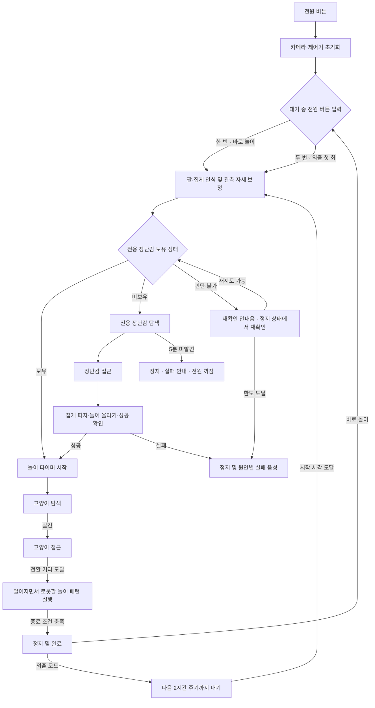

# 구조 및 인터페이스 설계

## 1. 범위와 시작 조건

FishingBot은 MuJoCo에서 시뮬레이션한다. 이동부, 로봇팔, 집게, 장난감, 고양이 대상, 장애물과 로봇 카메라를 MJCF로 모델링한다. 인식 모듈은 로봇 카메라에서 렌더링한 영상을 받고, 제어기는 바퀴·관절·집게의 액추에이터에 명령을 보낸다.

이 문서는 [문제 정의](problem.md)와 [요구사항](requirements.md)을 구현하기 위한
시뮬레이션 소프트웨어 설계이다. 실제 실행 코드와 하드웨어 전원 회로는 아직 구현하지 않는다.
시뮬레이션에서 같은 전원 버튼은 꺼짐 상태에서 `POWER_ON`, 켜진 대기 상태에서 단일 또는 이중 누름 이벤트를 발생시킨다.

전원 입력 후 카메라와 제어기를 초기화하고 자동 놀이 모드 선택을 기다린다. 놀이 한 회를 시작할 때마다 카메라로 팔·집게 위치를 먼저 확인한다.
위치 수정은 팔을 확인 가능한 관측 자세로 보정하는 것으로 정의한다.
이 과정에서는 이동부를 정지하고 집게의 기존 파지를 유지한다.
팔을 보지 못하거나 현재 관절 상태를 확인할 수 없으면 임의로 움직이지 않고 정지한다.
카메라 시야와 초기 자세를 설계하여 팔·집게가 보이도록 해야 한다.

## 2. 동작 흐름

꺼진 상태에서 전원 버튼을 한 번 누르면 부팅하고 대기한다. 전원을 켠 누름은 이때 소비한다.
대기 중 새로 한 번 누르면 바로 놀이, 두 번 연속 누르면 외출 모드를 시작한다. 첫 누름 뒤 연속 입력 판정 시간이 끝나야 단일 누름을 확정한다. 그 안에 두 번째 누름이 들어오면 외출 모드 이벤트만 한 번 발행한다.

| 자동 놀이 모드 | 한 회를 시작하는 조건 | 정상 완료 후 |
| --- | --- | --- |
| 바로 놀이 | 단일 누름 확정 시 한 회 시작 | 전원이 켜진 대기로 복귀 |
| 외출 모드 | 이중 누름 확정 시 첫 회 시작. 설계 기본값은 활성화 시각 기준 2시간마다 한 회, 보유 확인부터 회당 10분 | 다음 예정 시각까지 대기. 사용자 정지 또는 전원 종료 시 예정 회차 취소 |

두 모드 모두 회차에서 처음 HELD가 확인된 시각을 한 번만 기록해 놀이 시간을 잰다. 이미 들고 있으면 보정 후 보유 확인 시점, 새로 집으면 집어 든 뒤 보유 확인 시점이다. 이후 고양이 탐색·접근·회피 시간도 포함한다. 외출 모드에서 10분이 차면 현재 동작을 정지하고 회차를 완료한다.

빈 집게로 장난감 탐색을 시작할 때 별도로 5분 기한을 기록한다. 그 안에 발견하면 접근·파지를 진행한다. 탐색 중 회피하거나 목표를 잃어 다시 찾더라도 최초 기한을 유지한다. 기한에 유효한 장난감을 찾지 못한 상태이면 정지하고 외출 예약을 취소한 뒤 실패 음성을 안내하고 전원을 끈다.

보유 확인 재시도와 탐색에는 횟수 또는 시간 제한을 둔다. 제한에 도달하면 정지하고
실패를 반환한다. 그림의 정상 흐름 외 예외는 아래 상태 전이 규칙을 따른다.

## 3. 모듈 구조

| 모듈 | 책임 | 주요 입력 | 주요 출력 |
| --- | --- | --- | --- |
| Camera | 영상과 보정 정보 제공 | 카메라 설정 | 프레임, 촬영 시각, 카메라 좌표계 |
| Perception | 팔·집게, 전용 장난감, 고양이 인식 및 위치 추정 | 카메라 프레임 | 인식 결과, 유효 여부 |
| Coordinator | 상태 전이와 명령 발행, 보유 여부 판단 | 전원·정지 이벤트, 인식·제어 결과 | 구동부·팔 명령, 시스템 상태 |
| Drive | 탐색 이동, 대상 접근, 멀어지기, 랜덤 회피 | 이동 명령, 대상 추정 위치, 장애물 정보 | 실행 상태, 이동부 상태 |
| Arm | 관측 자세 보정, 파지, 들어 올리기, 파지 유지 | 팔 명령, 파지 목표 자세 | 실행 상태, 관절·집게·파지 상태 |
| Audio | 재확인 안내음과 원인별 실패 음성 재생 | Coordinator의 알림 이벤트 | 사용자에게 들리는 소리 |
| Simulation | 로봇·대상·카메라·장애물 표현과 결과 기록 | 제어 출력, 초기 조건 | 영상, 관절·접촉 상태, 검증 기록 |

Coordinator만 자동 작업 명령을 발행한다. Drive와 Arm은 인식 결과만 보고 독자적으로
다음 작업을 시작하지 않는다. 사용자 정지와 충돌 방지는 모든 작업 명령보다 우선한다.
장난감과 고양이 위치의 제어 입력은 영상 추정값을 사용하며, 시뮬레이터 실제 좌표는 평가에만 사용한다.

## 4. 상태 전이 규칙

| 상태 | 수행 작업 | 성공 시 | 실패·예외 시 |
| --- | --- | --- | --- |
| OFF | 명령 발행 없음 | POWER_ON → INITIALIZING | — |
| INITIALIZING | 카메라·구동부·팔 준비 확인 | SELECT_MODE | 초기화 시간 초과 → FAULT |
| SELECT_MODE | 전원 버튼 단일·이중 누름 판정 대기 | 단일 → 바로 놀이, 이중 → 외출 모드. 모두 첫 회 ALIGN_ARM | — |
| WAIT_TRIGGER | 이동부와 팔을 정지하고 외출 모드의 다음 시작 시각까지 대기 | 예정 시각 도달 → ALIGN_ARM | 사용자 정지 → STOPPED |
| ALIGN_ARM | 팔·집게 인식, 파지 유지하며 관측 자세로 보정 | CHECK_TOY | 인식·보정 실패 → FAULT |
| CHECK_TOY | 최신 영상과 파지 상태로 보유 여부 확인 | HELD → SEARCH_CAT, EMPTY → SEARCH_TOY | UNKNOWN → 제한된 재확인, 초과 → FAULT |
| SEARCH_TOY | 첫 탐색 시작부터 5분간 전용 장난감 탐색 | 유효한 목표 발견 → APPROACH_TOY | 미발견 기한 만료 → 정지·안내 후 OFF |
| APPROACH_TOY | 파지 가능한 위치로 접근 | 정지·목표 재확인 후 → PICK_TOY | 목표 소실 → 정지 후 SEARCH_TOY |
| PICK_TOY | 정지 상태에서 집기·들어 올리기·보유 확인 | HELD → SEARCH_CAT | 실패·시간 초과 → FAULT |
| SEARCH_CAT | 장난감을 유지하며 고양이 탐색 | 유효한 고양이 발견 → APPROACH_CAT | 탐색 시간 초과 → FAULT |
| APPROACH_CAT | 고양이 위치를 갱신하며 접근 | 전환 거리 도달 → RETREAT | 고양이 소실 → 정지 후 SEARCH_CAT |
| RETREAT | 고양이 위치를 갱신하며 이동부는 멀어지고 팔은 장난감 패턴 실행 | 종료 조건 충족 → 두 동작 정지 후 COMPLETED | 고양이 소실·패턴 실패 → 두 동작 정지 후 FAULT |
| AVOID_OBSTACLE | 정지 → 좌우 랜덤 90도 회전 시도 → 전방 재확인 | 대상·보유 상태 재확인 후 직전 상태 재개 | 최대 시도 초과 → FAULT |
| STOPPED | 이동·팔 동작 정지, 집게 파지 유지 | 명시적 재시작 → INITIALIZING | 자동 재개하지 않음 |
| FAULT | 정지, 실패 원인 출력, 집게 파지 유지 | 원인 해소 후 명시적 재시작 → INITIALIZING | 자동 재개하지 않음 |
| COMPLETED | 한 회 완료 기록, 정지 및 파지 유지 | 바로 놀이 → SELECT_MODE, 외출 → WAIT_TRIGGER | — |

- 탐색은 대상의 유효한 위치가 없는 상태에서도 수행할 수 있다. 오래된 좌표를 따라가지 않고,
  별도의 탐색 명령으로 관측·이동하며 장애물 확인이 불가능하면 정지한다.
- 이동 상태에서 장애물을 감지하면 직전 상태를 저장하고 AVOID_OBSTACLE로 전환한다.
  몸체·팔·장난감의 회전 경로가 막혀 있으면 회전을 중단하고 시도 횟수를 증가시킨다.
- 고양이 탐색·접근·멀어지기·그 과정의 회피 중 파지 상실 또는 보유 판단 불가 시 정지하고 FAULT로 전환한다.
- 모든 활성 상태에서 STOP 입력을 받으면 진행 중 명령을 취소하고 STOPPED로 전환한다.
- 재시작 시 이전 작업의 지연된 결과로 상태가 전환되지 않도록 명령 식별자를 새로 발급한다.

## 5. 전용 장난감 보유 판단

| 값 | 의미 | 판정 조건 | 분기 |
| --- | --- | --- | --- |
| HELD | 전용 장난감을 실제로 잡고 있음 | 전용 표식 확인 + 집게 파지 증거 + 집게와 장난감의 상대 위치 안정 | 고양이 탐색 |
| EMPTY | 집게가 비어 있음 | 집게 내부가 유효하게 관측되고 파지 상태도 비어 있음을 나타냄 | 장난감 탐색 |
| UNKNOWN | 보유 여부를 판단할 수 없음 | 가림, 오래된 영상, 집게 상태 불명 또는 영상과 파지 상태 불일치 | 정지·재확인 |

장난감이 화면에 보이는 것만으로 HELD로 판정하지 않는다. 집게가 닫혔다는 신호만으로도
HELD로 판정하지 않는다. 다른 물체를 잡았거나 시야가 가려진 경우에는 UNKNOWN으로 처리한다.
확인 프레임 수, 상대 위치 허용 오차와 결과 유효 시간은 설정값으로 관리한다.
시뮬레이션에서는 접촉·결합 상태를 파지 증거로 사용할 수 있다.

## 6. 모듈 간 인터페이스 초안

통신 방식은 미정이며 아래는 라이브러리·ROS 등에 종속되지 않는 데이터 계약이다.
위치는 m, 각도는 rad, 시간은 MuJoCo의 시뮬레이션 시각(`mjData.time`, 초)을 사용한다. 장난감 탐색 5분, 보유 확인부터의 외출 놀이 10분, 외출 회차 간격 2시간을 모두 이 시계로 검증한다.
로봇 기준 좌표계는 `base_link`로 이름을 정하고 x=전방, y=좌측, z=상방으로 사용한다.
카메라 좌표는 촬영 시각의 변환 정보를 사용해 변환하며 변환이 없으면 결과를 무효 처리한다.

### 인식 및 보유 상태

| 데이터 | 필수 필드 | 규칙 |
| --- | --- | --- |
| Observation | target: ARM / GRIPPER / TOY / CAT, detected, valid, captured_at_s, frame_id, position_m, orientation_xyzw | 위치는 x·y·z, 방향은 쿼터니언 x·y·z·w. 미검출·무효 또는 추정 불가 필드는 null이며 0으로 대체하지 않는다. |
| GraspStatus | state: HELD / EMPTY / UNKNOWN, observed_at_s, evidence | Arm의 파지 증거를 포함하며 최종 전용 장난감 보유 판단은 Coordinator가 영상과 결합해 수행한다. |
| RobotStatus | ready, observed_at_s, joint_positions_rad, gripper_state | 보정 전 관절 상태와 제어기 준비 여부 확인에 사용한다. |

장난감 파지는 위치·방향이 모두 유효해야 한다. 고양이 제어에는 유효한 위치가 필요하며
고양이 자세 방향은 필수가 아니다. 선택한 대상이 바뀌면 기존 접근 명령을 취소하고 재평가한다.

### 명령 및 결과

| 수신 모듈 | 명령 | 추가 입력 |
| --- | --- | --- |
| Drive | SEARCH | target: TOY / CAT, 탐색 시간 제한 |
| Drive | APPROACH | target, 최신 Observation, 목표 거리 |
| Drive | RETREAT | 최신 CAT Observation, 종료 조건 |
| Drive | TURN | angle_rad: +π/2 또는 -π/2, 충돌 확인 조건 |
| Arm | ALIGN_FOR_INSPECTION | 최신 ARM·GRIPPER Observation, RobotStatus, preserve_grasp: true |
| Arm | PICK_AND_LIFT | 최신 TOY Observation, 파지 자세·들어 올릴 높이 |
| Arm | PLAY_PATTERN | pattern_id, 패턴별 속도·동작 범위, preserve_grasp=true |
| Drive / Arm | STOP | 중단 대상 command_id, reason |

- 모든 명령은 `command_id`, `issued_at_s`, `timeout_s`를 포함한다.
- 결과는 `command_id`, `status`(RUNNING / SUCCEEDED / FAILED / CANCELLED), `reason`, `observed_at_s`를 포함한다.
- 대상 위치 갱신은 `command_id`와 최신 Observation을 함께 전달한다. 수신부는 촬영 시각과
  좌표계를 검증하고 유효 시간이 지난 결과로 동작하지 않는다.
- STOP은 집게 열기를 의미하지 않는다. 들고 있던 장난감을 떨어뜨리지 않도록 파지를 유지한다.
- 상태 출력은 현재 상태, 보유 상태, 활성 명령, 회피 시도 횟수, 실패 원인을 포함한다.

### 사용자에게 들리는 알림

Coordinator는 보유 판단이 UNKNOWN이 되어 재확인을 시작하거나, FAULT에 진입하거나, 장난감 미발견으로 전원을 끌 때 Audio에
`event_id`, `state`, `reason`을 전달한다. Audio는 같은 이벤트를 한 번만 재생한다.
재확인이 계속되는 동안 프레임마다 다시 울리지 않는다. 재확인 중 최종 실패가 확정되면
실패 안내를 우선 재생한다. 정지 명령은 재생 완료를 기다리지 않는다.

| 상황 | 사용자에게 들리는 소리의 초안 |
| --- | --- |
| 보유 여부 재확인 중 | 짧은 두 음 뒤 “장난감을 들고 있는지 다시 확인하고 있어요.” |
| 보유 여부 확인 한도 도달 | “장난감을 들고 있는지 확인할 수 없어 멈췄어요.” |
| 장난감 파지 실패 / 이동 중 파지 상실 | 각각 “장난감을 집지 못했어요.” / “이동 중 장난감을 놓쳤어요.” |
| 탐색 시간 초과 | 탐색 대상에 따라 “장난감을 찾지 못했어요.” 또는 “고양이를 찾지 못했어요.” |
| 그 밖의 실패 | 상태와 원인에 맞는 한국어 음성 재생. 예를 들어 회피 한도 도달 시 “장애물을 피하지 못해 멈췄어요.” |

### 이동 중 로봇팔 놀이 패턴

전환 거리 이하에서 RETREAT에 진입하면 Coordinator가 현재 자세에서 실행 가능한 지정 패턴 중 하나를 무작위로 선택한다.
같은 제어 주기에 Drive에 RETREAT, Arm에 PLAY_PATTERN을 각각 발행한다. 서로 다른 명령 ID로 두 결과를 추적한다.

| 패턴 ID | 집게가 장난감을 잡은 채 수행할 한 주기 |
| --- | --- |
| SHAKE | 집게 끝을 기준 위치에서 좌우로 흔들고 기준 위치로 돌아온다. |
| CIRCLE | 집게 끝으로 몸체 기준 수직 평면에 작은 원을 한 바퀴 그려 시작점으로 돌아온다. |

흔들림 폭, 원의 반지름, 주기는 설정값으로 둔다. 관절 범위와 이동 중 팔·장난감의 예상 경로를 확인해 후보를 고른다.
한 주기를 마칠 때도 멀어지는 중이면 다음 패턴을 다시 뽑는다. 종료 조건이나 사용자 정지가 먼저 들어오면
진행 중인 패턴을 즉시 중단한다. 장애물을 만나면 패턴과 주행을 멈춘 뒤 기존 회피 절차를 수행하며,
고양이 위치와 파지를 재확인하고 멀어지기를 재개할 때 새 패턴을 고른다. 파지 상실, 패턴 실행 실패,
실행 가능한 후보 부재 시에는 두 명령을 중단하고 원인에 맞는 실패 음성을 재생한다.

## 7. 검증 시나리오

| 시나리오 | 기대 결과 |
| --- | --- |
| 꺼짐 상태에서 한 번 누른 뒤 추가 입력 없음 | 초기화 후 대기 유지 |
| 대기 중 두 번 누름, 장난감 보유 | 외출 첫 회만 시작. 보정 후 보유 확인 시 타이머 시작 |
| 대기 중 한 번 누름, 장난감 미보유 | 바로 놀이 한 회 시작. 탐색 중에는 놀이 시간이 흐르지 않고 파지 성공 시 시작 |
| 외출 첫 회를 13:00에 시작하고 13:03에 파지 성공 | 정상 진행 시 13:13에 정지, 다음 회차는 15:00에 시작 |
| 두 모드에서 각각 장난감 미발견이 5분 지속 | 정지와 실패 안내 후 OFF. 외출 모드에서도 다음 주기에 자동으로 켜지지 않음 |
| 팔 또는 집게가 카메라에 보이지 않음 | 임의 동작 없이 정지·실패 출력 |
| 장난감이 집게 근처에만 놓여 있음 | HELD로 오판하지 않음 |
| 파지 상태와 영상이 불일치 | UNKNOWN으로 재확인하고 제한 초과 시 정지 |
| 고양이가 처음에 보이지 않음 | 오래된 위치를 따라가지 않고 제한된 탐색 수행 |
| 파지 실패 또는 이동 중 장난감 상실 | 고양이 접근을 시작하지 않거나 진행 중 동작 정지 |
| 장애물 회피로 고양이가 시야에서 사라짐 | 회피 후 재인식 전 일반 이동 금지 |
| 정지 후 이전 명령 결과 수신 | 정지 상태 유지, 오래된 결과 무시 |
| UNKNOWN 지속 후 확인 한도 도달 | 재확인 음성이 한 번 들리고 최종 실패 시 확인 실패 음성이 한 번 들림 |
| 전환 거리 통과 후 멀어지기 | 주행과 팔 동작의 실행 시간이 겹치며, 패턴별 시나리오에서 좌우 왕복 또는 원 한 바퀴 궤적 확인 |
| 놀이 도중 장애물·정지 입력 | 회피 회전 전에 팔 동작 중단, 사용자 정지 시 두 명령 모두 취소 |

## 8. 확정이 필요한 설정

- 팔·집게를 볼 수 있는 카메라 배치, 초기 자세, 관측 자세와 보정 허용 오차
- 전용 표식, 보유 확인 프레임 수, 파지 증거와 상대 위치 허용 오차
- 버튼 연속 누름 판정 시간, 탐색 경로·이동 속도, 고양이 탐색 제한 시간, 보유 재확인 횟수
- 고양이 전환 거리, 멀어지기 종료 조건, 대상 재인식 제한 시간
- 장애물 감지 거리, 회피 최대 횟수, 회전 충돌 범위
- 통신 방식, 카메라 보정·좌표 변환 방법, 인식 결과 유효 시간
