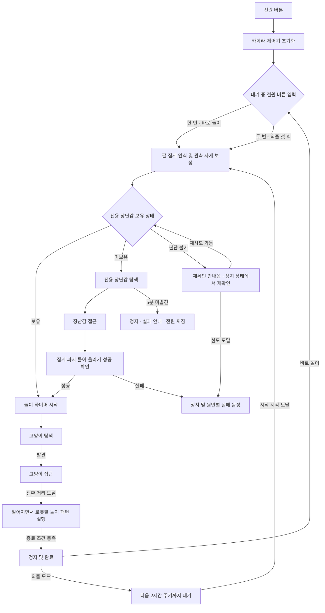
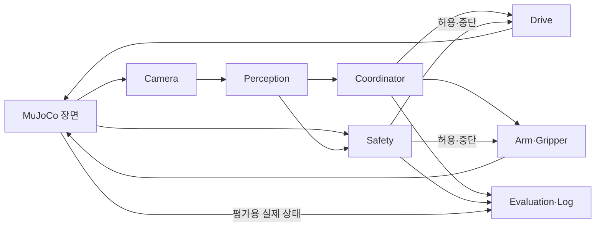

# FishingBot 시스템·장면·안전 설계

## 1. 범위와 시작 조건

FishingBot은 별도로 놓인 낚싯대를 집어 고양이 놀이 동작을 수행하는 이동형 로봇이다.
MuJoCo에서 Stanford TidyBot을 기반으로 이동부·팔·집게와 작업 장면을 MJCF로 구성한다.
인식 모듈은 로봇 카메라 영상을 받고, 제어기는 이동부·관절·집게의 액추에이터에 명령을 보낸다.

이 문서는 [문제 정의](problem.md)와 [요구사항](requirements.md)을 구현하기 위한
시뮬레이션 소프트웨어 설계이다. 수업 자료의 D06 시스템 구조·인터페이스, D07 장면 구성표,
D08 안전 개념을 이 문서에서 함께 관리한다. D07 초안 장면은 [scenes/fishingbot.xml](../scenes/fishingbot.xml)에 구현했다.
제어 시퀀스는 아직 구현하지 않았다. 실행법·임시 배치값·장면 검사 결과는 [장면 실행 안내](scene.md)에 기록한다.

### 개발 단계

| 구분 | 범위 | 완료 기준 |
| --- | --- | --- |
| 첫 구현 v0 | 낚싯대 위치 확인 → 본체 접근 → 정지 → 재인식 → 파지·들어 올리기 → 정지 상태 흔들기 | 파지를 유지하며 지정 횟수 흔들고, 기준 자세에서 정지 |
| 이후 통합 | 초기 보유 분기, 고양이 탐색·접근, 멀어지며 놀이, 장애물 회피, 자동 놀이 모드·음성 안내 | 기존 요구사항의 전체 흐름 및 실패 시나리오 검증 |

첫 구현에서는 빈 집게로 시작하고 로봇·장난감 통·낚싯대 초기 위치를 고정한다.
낚싯대를 잡은 채 본체가 이동하는 기능과 장난감 통 반납은 v0에 포함하지 않는다.
이후 통합 기능은 삭제하지 않고 아래의 공통 모듈·상태·인터페이스를 확장해 연결한다.

### 모델과 장면 구성표 — D07

| 항목 | 결정 및 설계 초안 | 상태 |
| --- | --- | --- |
| 로봇 | Stanford TidyBot 기반 낮은 본체 + 단순한 4관절 팔 + 평행 집게 | 단순 팔 안 선택, 시뮬레이션용 커스텀 모델 |
| 본체·팔 | 본체 시각·충돌 메시 높이를 원본의 50%로 축소, 팔 장착 높이 0.16m. 팔은 좌우 회전·어깨·팔꿈치·손목의 4축, 집게는 한 명령으로 개폐 | 가로·세로 유지, 질량·관성은 현재 모델 설정으로 계산. 실제 하드웨어 제원 아님 |
| 이동 모델 | Menagerie 모델의 평면 X·Y 이동 및 회전 관절 사용. Drive가 전진·후진·회전 명령을 이 관절 명령으로 변환 | 실제 바퀴 구동·미끄러짐 검증과 구분 |
| 작업 물체 | 로봇에 고정하지 않은 독립 낚싯대 세트 1개. 손잡이·막대는 강체로, 줄과 끝 장난감은 연결된 구성으로 설계 | 구성 합의, 줄 모델링 방식 미정 |
| 손잡이 | 길이 0.10m, 지름 0.03m. 중앙에 색상 표식 부착 | 초기 제원 |
| 막대 | 손잡이 포함 전체 길이 0.30m | 초기 제원 |
| 줄·끝 장난감 | 줄 길이 0.20m, 끝 장난감은 지름 0.05m 공 | 초기 제원 |
| 질량 | 세트 전체 목표 0.10kg. 부품별 질량 배분은 미정 | 모델링 후 질량 합 확인 |
| 장난감 통 | 열린 원통형 통 1개, 높이 0.26m·외경 0.15m. 내부 가이드에 막대를 세우고 손잡이 위쪽 약 0.08m만 노출. 줄·끝 장난감은 통 안에 보관 | 통 중심 (0.75, 0, 0)m, 치수·배치는 초기 시험값 |
| 공간 | 3m × 3m 평면, 장난감 통과 로봇 사이에 접근 공간 확보, 가상 작업 경계 설정 | 초기 배치안 |
| 센서 | 본체 앞 짧은 지지대의 RGB·깊이 카메라, 양쪽 집게 접촉 정보 | 카메라 본체 기준 (0.28, 0, 0.24)m, 수직 시야각 60°로 임시 배치 |
| 대상·장애물 | v0 정상 장면은 고양이·추가 장애물 없이 시작. 안전 시험에 대체 물체를 추가 | 이후 통합에서 고양이 모형·장애물 배치 |
| 무작위 요소 | v0는 고정 배치. 이후 낚싯대 위치·방향을 도달 가능한 범위에서 변경하고 난수 시드 기록 | 범위 미정 |

원본 모델: [MuJoCo Menagerie / Stanford TidyBot](https://github.com/google-deepmind/mujoco_menagerie/tree/main/stanford_tidybot).
크기를 바꾸면 시각·충돌 형상, 관절 위치, 질량·무게중심·관성을 함께 검토한다.
모델 원본 버전과 라이선스, 변경한 제원은 실제 도입 시 기록한다.

장면 제작 시 통 높이·손잡이 노출 길이, 집기 위치, 로봇 시작 자세, 카메라 배치를 함께 조정한다.
전체 로봇과 낚싯대·줄·장난감의 예상 이동 범위가 경계 안에 있어야 한다.
바닥과 통 내부 가이드의 의도된 지지 접촉은 허용하지만, 초기 관통이나 집게 접근을 막는 배치는 허용하지 않는다.
기존의 줄 없는 표식 막대는 파지 원인을 분리하는 비교 시험에 사용할 수 있으며,
그 결과로 줄이 있는 장면의 안정성이나 얽힘 방지를 통과했다고 판단하지 않는다.

### 검증 입력의 구분

| 시험 구분 | 대상 위치 입력 | 결과 해석 |
| --- | --- | --- |
| 개발용 동작 시험 | MuJoCo 실제 좌표 | 도달·파지·흔들기 제어를 따로 점검. 카메라 인식 요구 충족으로 인정하지 않음 |
| v0 통합 및 요구사항 검증 | RGB·깊이 영상으로 추정한 손잡이 위치·방향 | 실제 좌표는 인식 오차 평가에만 사용 |

두 시험의 입력 출처와 결과를 분리해 기록한다. 이후 고양이 위치도 영상 추정값을 사용한다.

### 이후 통합의 시작 조건

전원 입력 후 카메라와 제어기를 초기화하고 자동 놀이 모드 선택을 기다린다. 놀이 한 회를 시작할 때마다 카메라로 팔·집게 위치를 먼저 확인한다.
위치 수정은 팔을 확인 가능한 관측 자세로 보정하는 것으로 정의한다.
이 과정에서는 이동부를 정지하고 집게의 기존 파지를 유지한다.
팔을 보지 못하거나 현재 관절 상태를 확인할 수 없으면 임의로 움직이지 않고 정지한다.
카메라 시야와 초기 자세를 설계하여 팔·집게가 보이도록 해야 한다.

## 2. 동작 흐름

### v0: 접근·정지·파지·흔들기

| 단계 | 수행 동작 | 다음 단계 조건 |
| --- | --- | --- |
| 위치 확인 | 색상 표식으로 손잡이 중심과 낚싯대 방향 추정 | 최신의 유효한 위치·방향 확보 |
| 접근 | 손잡이 자체가 아닌, 팔로 집을 수 있는 본체 목표 위치로 이동. 도착 직전 감속 | 목표 위치·방향 허용 오차 이내 |
| 정지 확인 | 본체 이동·회전 정지 후 손잡이를 다시 관측 | 정지 유지 조건 및 재인식 성공 |
| 파지 | 집게 열기 → 손잡이 위 사전 접근 자세 → 손잡이 중앙으로 하강 → 집게 닫기 | 양쪽 손가락 접촉 확인 |
| 파지 검증 | 조금 들어 장난감 통에서 분리하고 유지 | 들어 올림과 상대 위치 안정 확인. 세부 판정은 5절 |
| 놀이 자세 | 장난감 통와 간격을 확보하고 흔들기 경로 확인 | 경로 유효, 파지 유지, 본체 정지 |
| 흔들기 | 기준 자세에서 손목 회전을 중심으로 좌우 왕복, 부드러운 가감속 | 지정 반복 완료 및 기준 자세 복귀 |
| 완료 | 본체·팔 동작 정지, 낚싯대 파지 유지 | 완료 상태·로그 출력 |

초기 수치는 9절에서만 관리한다. 집게가 손잡이를 잡는 방향과 사전 접근 자세는
커스텀 팔의 관절 범위·충돌·도달 시험 후 정한다. 목표가 도달 불가능하면 팔을 움직이지 않고 실패를 반환한다.
각 단계에는 제한 시간을 두며 정지·재인식·파지 확인 중에는 본체 이동을 허용하지 않는다.

### 이후 통합: 자동 놀이

꺼진 상태에서 전원 버튼을 한 번 누르면 부팅하고 대기한다. 전원을 켠 누름은 이때 소비한다.
대기 중 새로 한 번 누르면 바로 놀이, 두 번 연속 누르면 외출 모드를 시작한다. 첫 누름 뒤 연속 입력 판정 시간이 끝나야 단일 누름을 확정한다. 그 안에 두 번째 누름이 들어오면 외출 모드 이벤트만 한 번 발행한다.

| 자동 놀이 모드 | 한 회를 시작하는 조건 | 정상 완료 후 |
| --- | --- | --- |
| 바로 놀이 | 단일 누름 확정 시 한 회 시작 | 전원이 켜진 대기로 복귀 |
| 외출 모드 | 이중 누름 확정 시 첫 회 시작. 설계 기본값은 활성화 시각 기준 2시간마다 한 회, 보유 확인부터 회당 10분 | 다음 예정 시각까지 대기. 사용자 정지 또는 전원 종료 시 예정 회차 취소 |

두 모드 모두 회차에서 처음 HELD가 확인된 시각을 한 번만 기록해 놀이 시간을 잰다. 이미 들고 있으면 보정 후 보유 확인 시점, 새로 집으면 집어 든 뒤 보유 확인 시점이다. 이후 고양이 탐색·접근·회피 시간도 포함한다. 외출 모드에서 10분이 차면 현재 동작을 정지하고 회차를 완료한다.

빈 집게로 장난감 탐색을 시작할 때 별도로 5분 기한을 기록한다. 그 안에 발견하면 접근·파지를 진행한다. 탐색 중 회피하거나 목표를 잃어 다시 찾더라도 최초 기한을 유지한다. 기한에 유효한 장난감을 찾지 못한 상태이면 정지하고 외출 예약을 취소한 뒤 실패 음성을 안내하고 전원을 끈다.

보유 확인 재시도와 탐색에는 횟수 또는 시간 제한을 둔다. 제한에 도달하면 정지하고
실패를 반환한다. 그림의 정상 흐름 외 예외는 아래 상태 전이 규칙을 따른다.

## 3. 모듈 구조

| 모듈 | 책임 | 주요 입력 | 주요 출력 |
| --- | --- | --- | --- |
| Camera | 영상과 보정 정보 제공 | 카메라 설정 | 프레임, 촬영 시각, 카메라 좌표계 |
| Perception | 팔·집게, 전용 장난감, 고양이 인식 및 위치 추정 | 카메라 프레임 | 인식 결과, 유효 여부 |
| Coordinator | 상태 전이와 명령 발행, 보유 여부 판단 | 전원·정지 이벤트, 인식·제어 결과 | 구동부·팔 명령, 시스템 상태 |
| Drive | 탐색 이동, 대상 접근, 멀어지기, 랜덤 회피 | 이동 명령, 대상 추정 위치, 장애물 정보 | 실행 상태, 이동부 상태 |
| Arm | 관측 자세 보정, 파지·들어 올리기·유지, 놀이 자세 이동과 패턴 실행 | 팔 명령, 목표 자세·패턴 설정 | 실행 상태, 관절·집게·파지 상태 |
| Safety | 정지 조건, 경계·충돌·명령 유효성·파지 상실 감시 | 명령, 로봇·접촉·인식 상태 | 동작 허용 여부, 정지 사유 |
| Audio | 재확인 안내음과 원인별 실패 음성 재생 | Coordinator의 알림 이벤트 | 사용자에게 들리는 소리 |
| Simulation | 장면 표현, 물리 시간 진행(`mj_step`), 센서 정보 제공 | 제어 출력, 초기 조건 | 영상, 관절·접촉 상태, 시뮬레이션 시각 |
| Evaluation / Log | 성공·실패 판정, 인식 오차 및 이벤트 기록 | 각 모듈 상태, 평가용 실제 좌표 | 판정 결과, JSON 한 줄 이벤트 |

Coordinator만 자동 작업 명령을 발행한다. Drive와 Arm은 인식 결과만 보고 독자적으로
다음 작업을 시작하지 않는다. Safety는 Coordinator와 별도로 Drive·Arm 명령을 차단할 수 있다.
명령 우선순위는 사용자 정지·안전 중단 → 장애물 회피 → 일반 작업이다.
Audio와 고양이 관련 기능은 이후 통합에서 연결한다.

## 4. 상태 전이 규칙

v0 검증은 초기 준비 후 `SEARCH_TOY`부터 시작한다. 고정 배치에서의 위치 확인이며,
미검출 시 정지 상태에서 제한된 재관측을 수행한다. 전원·모드 선택과 이동하며 탐색하기는 이후 통합 범위이다.
아래 표에서 v0와 이후 통합의 분기가 다른 곳은 각각 명시한다.

| 상태 | 수행 작업 | 성공 시 | 실패·예외 시 |
| --- | --- | --- | --- |
| OFF | 명령 발행 없음 | POWER_ON → INITIALIZING | — |
| INITIALIZING | 카메라·구동부·팔 준비 확인 | SELECT_MODE | 초기화 시간 초과 → FAULT |
| SELECT_MODE | 전원 버튼 단일·이중 누름 판정 대기 | 단일 → 바로 놀이, 이중 → 외출 모드. 모두 첫 회 ALIGN_ARM | — |
| WAIT_TRIGGER | 이동부와 팔을 정지하고 외출 모드의 다음 시작 시각까지 대기 | 예정 시각 도달 → ALIGN_ARM | 사용자 정지 → STOPPED |
| ALIGN_ARM | 팔·집게 인식, 파지 유지하며 관측 자세로 보정 | CHECK_TOY | 인식·보정 실패 → FAULT |
| CHECK_TOY | 이후 통합: 최신 영상과 파지 상태로 보유 여부 확인 | HELD → SEARCH_CAT, EMPTY → SEARCH_TOY | UNKNOWN → 제한된 재확인, 초과 → FAULT |
| SEARCH_TOY | v0는 정지 관측, 이후 통합은 제한된 탐색 이동 | 유효한 목표 발견 → APPROACH_TOY | v0 시간 초과 → FAULT. 이후 통합의 미발견 기한 만료 → 정지·안내 후 OFF |
| APPROACH_TOY | 파지 가능한 본체 위치로 접근 | 목표 도착 → STOP_AND_REOBSERVE | 목표 소실 → 정지 후 SEARCH_TOY, 접근 시간 초과 → FAULT |
| STOP_AND_REOBSERVE | 정지 유지 및 손잡이 위치·방향 재확인 | 정지·인식 조건 충족 → PICK_TOY | 재인식 실패·시간 초과 → FAULT |
| PICK_TOY | 정지 상태에서 접근·집게 닫기·들어 올리기 | 접촉·들어 올림 확인 → VERIFY_GRASP | 실패·시간 초과 → FAULT |
| VERIFY_GRASP | 유지 관측으로 전용 장난감 파지 확인 | HELD이면 v0 → PREPARE_SHAKE, 이후 통합 → SEARCH_CAT | 미끄러짐·UNKNOWN·시간 초과 → FAULT |
| PREPARE_SHAKE | 본체 정지 유지, 장난감 통에서 떨어진 놀이 자세로 이동 | 경로·파지 유효 → SHAKE | 도달 불가·경로 충돌·파지 상실 → FAULT |
| SHAKE | v0: 본체 정지 상태에서 지정 왕복 실행 | 기준 자세 복귀 → COMPLETED | 파지 상실·충돌·시간 초과 → FAULT |
| SEARCH_CAT | 장난감을 유지하며 고양이 탐색 | 유효한 고양이 발견 → APPROACH_CAT | 탐색 시간 초과 → FAULT |
| APPROACH_CAT | 고양이 위치를 갱신하며 접근 | 전환 거리 도달 → RETREAT | 고양이 소실 → 정지 후 SEARCH_CAT |
| RETREAT | 고양이 위치를 갱신하며 이동부는 멀어지고 팔은 장난감 패턴 실행 | 종료 조건 충족 → 두 동작 정지 후 COMPLETED | 고양이 소실·패턴 실패 → 두 동작 정지 후 FAULT |
| AVOID_OBSTACLE | 정지 → 좌우 랜덤 90도 회전 시도 → 전방 재확인 | 대상·보유 상태 재확인 후 직전 상태 재개 | 최대 시도 초과 → FAULT |
| STOPPED | 이동·팔 동작 정지, 집게 파지 유지 | 명시적 재시작 → 아래의 단계별 재시작 규칙 | 자동 재개하지 않음 |
| FAULT | 정지, 실패 원인 출력, 집게 파지 유지 | 원인 해소 후 명시적 재시작 → 아래의 단계별 재시작 규칙 | 자동 재개하지 않음 |
| COMPLETED | 한 회 완료 기록, 정지 및 파지 유지 | v0는 명시적 재설정 전 유지. 이후 통합은 바로 놀이 → SELECT_MODE, 외출 → WAIT_TRIGGER | — |

- 탐색은 대상의 유효한 위치가 없는 상태에서도 수행할 수 있다. 오래된 좌표를 따라가지 않고,
  별도의 탐색 명령으로 관측·이동하며 장애물 확인이 불가능하면 정지한다.
- 이후 통합의 이동 상태에서 장애물을 감지하면 직전 상태를 저장하고 AVOID_OBSTACLE로 전환한다.
  몸체·팔·장난감의 회전 경로가 막혀 있으면 회전을 중단하고 시도 횟수를 증가시킨다.
- 고양이 탐색·접근·멀어지기·그 과정의 회피 중 파지 상실 또는 보유 판단 불가 시 정지하고 FAULT로 전환한다.
- 모든 활성 상태에서 STOP 입력을 받으면 진행 중 명령을 취소하고 STOPPED로 전환한다.
- 안전 이상은 FAULT로 전환한다. v0에서는 장애물 발견 시 정지·실패 처리하고 자동 우회하지 않는다.
- 고양이 접근·회피·예약 동작의 규칙은 이후 통합에만 적용한다.
- 재시작 시 이전 작업의 지연된 결과로 상태가 전환되지 않도록 명령 식별자를 새로 발급한다.
- v0 재시작은 정지·빈 집게·초기 배치를 다시 준비하고 SEARCH_TOY부터 시작한다. 이후 통합의 재시작은 INITIALIZING을 거친다.

## 5. 전용 장난감 보유 판단

| 값 | 의미 | 판정 조건 | 분기 |
| --- | --- | --- | --- |
| HELD | 전용 장난감을 실제로 잡고 있음 | 전용 표식 확인 + 집게 파지 증거 + 집게와 장난감의 상대 위치 안정 | v0는 놀이 자세 준비, 이후 통합은 고양이 탐색 |
| EMPTY | 집게가 비어 있음 | 집게 내부가 유효하게 관측되고 파지 상태도 비어 있음을 나타냄 | 장난감 탐색 |
| UNKNOWN | 보유 여부를 판단할 수 없음 | 가림, 오래된 영상, 집게 상태 불명 또는 영상과 파지 상태 불일치 | 정지·재확인 |

장난감이 화면에 보이는 것만으로 HELD로 판정하지 않는다. 집게가 닫혔다는 신호만으로도
HELD로 판정하지 않는다. 다른 물체를 잡았거나 시야가 가려진 경우에는 UNKNOWN으로 처리한다.
확인 프레임 수, 상대 위치 허용 오차와 결과 유효 시간은 설정값으로 관리한다.
시뮬레이션에서는 접촉·결합 상태를 파지 증거로 사용할 수 있다.
v0의 파지 검증은 양쪽 손가락 접촉, 장난감 통에서 들어 올림, 유지 시간 동안의 상대 위치·방향
안정을 함께 확인한다. 흔들기 중에도 파지를 감시한다. 제어 명령으로 물체를 집게에 강제 고정한 시험은
접촉 기반 파지 시험과 별도 기록하고, 강제 고정만으로 파지 성공을 인정하지 않는다.

## 6. 모듈 간 인터페이스 초안

통신 방식은 미정이며 아래는 라이브러리·ROS 등에 종속되지 않는 데이터 계약이다.
위치는 m, 각도는 rad, 시간은 MuJoCo의 시뮬레이션 시각(`mjData.time`, 초)을 사용한다. 장난감 탐색 5분, 보유 확인부터의 외출 놀이 10분, 외출 회차 간격 2시간을 모두 이 시계로 검증한다.
월드 좌표계는 `world`로 이름을 정하고 z=상방, 바닥의 두 축을 x·y로 사용한다.
로봇 기준 좌표계는 `base_link`로 이름을 정하고 x=전방, y=좌측, z=상방으로 사용한다.
손잡이 검출 결과는 촬영 시각의 변환으로 `world`에 표현하고, Drive·Arm에서 필요한 좌표계로 변환한다.
자세 데이터는 아래의 `orientation_xyzw`를 사용하며, 회전 목표·오차·속도에는 rad와 rad/s를 사용한다.
카메라 좌표는 촬영 시각의 변환 정보를 사용해 변환하며 변환이 없으면 결과를 무효 처리한다.

### 인식 및 보유 상태

| 데이터 | 필수 필드 | 규칙 |
| --- | --- | --- |
| Observation | target: ARM / GRIPPER / TOY / CAT, detected, valid, captured_at_s, frame_id, position_m, orientation_xyzw | 위치는 x·y·z, 방향은 쿼터니언 x·y·z·w. 미검출·무효 또는 추정 불가 필드는 null이며 0으로 대체하지 않는다. |
| GraspStatus | state: HELD / EMPTY / UNKNOWN, observed_at_s, evidence | Arm의 파지 증거를 포함하며 최종 전용 장난감 보유 판단은 Coordinator가 영상과 결합해 수행한다. |
| RobotStatus | ready, observed_at_s, joint_positions_rad, gripper_state | 보정 전 관절 상태와 제어기 준비 여부 확인에 사용한다. |
| DriveStatus | observed_at_s, frame_id, position_m, heading_rad, linear_speed_m_s, angular_speed_rad_s, position_error_m, heading_error_rad, stopped | 실제 위치·방향·속도와 도착 오차를 제공. `stopped`는 9절의 속도 임계값과 유지 시간으로 판단 |
| SafetyStatus | observed_at_s, allowed, reason, affected_command_ids | 허용=false이면 해당 동작 차단. 감시에 필요한 정보가 없거나 오래되면 허용하지 않음 |

장난감 파지는 위치·방향이 모두 유효해야 한다. 고양이 제어에는 유효한 위치가 필요하며
고양이 자세 방향은 필수가 아니다. 선택한 대상이 바뀌면 기존 접근 명령을 취소하고 재평가한다.

### 명령 및 결과

| 수신 모듈 | 명령 | 추가 입력 |
| --- | --- | --- |
| Drive | SEARCH | target: TOY / CAT, 탐색 시간 제한 |
| Drive | APPROACH | target, 최신 Observation, 목표 본체 위치·방향, frame_id, 속도 제한 |
| Drive | RETREAT | 최신 CAT Observation, 종료 조건 |
| Drive | TURN | angle_rad: +π/2 또는 -π/2, 충돌 확인 조건 |
| Arm | ALIGN_FOR_INSPECTION | 최신 ARM·GRIPPER Observation, RobotStatus, preserve_grasp: true |
| Arm | PICK_AND_LIFT | 최신 TOY Observation, 파지 자세·들어 올릴 높이 |
| Arm | PREPARE_SHAKE | 기준 놀이 자세, frame_id, 경로 충돌 확인 조건 |
| Arm | PLAY_PATTERN | pattern_id, 패턴별 속도·동작 범위, preserve_grasp=true |
| Drive / Arm | STOP | 중단 대상 command_id, reason |

- 모든 명령은 `command_id`, `issued_at_s`, `timeout_s`를 포함한다.
- 결과는 `command_id`, `status`(RUNNING / SUCCEEDED / FAILED / CANCELLED), `reason`, `observed_at_s`를 포함한다.
- 대상 위치 갱신은 `command_id`와 최신 Observation을 함께 전달한다. 수신부는 촬영 시각과
  좌표계를 검증하고 유효 시간이 지난 결과로 동작하지 않는다.
- STOP은 집게 열기를 의미하지 않는다. 들고 있던 장난감을 떨어뜨리지 않도록 파지를 유지한다.
- 상태 출력은 현재 상태, 보유 상태, 활성 명령, 회피 시도 횟수, 실패 원인을 포함한다.
- v0의 PICK_AND_LIFT·PREPARE_SHAKE·PLAY_PATTERN은 최신 DriveStatus의 정지 조건을 만족해야 한다.
  이후 통합에서 이동 중 PLAY_PATTERN은 RETREAT에만 허용하고 Safety가 경로를 확인한다.

### 전달 시점과 기록

| 보내는 쪽 → 받는 쪽 | 데이터 | 전달 시점 |
| --- | --- | --- |
| Camera → Perception | RGB 배열, 깊이 배열(m), 촬영 시각·카메라 보정 정보 | 인식 주기마다 |
| Perception → Coordinator | Observation | 최초 인식, 접근 중 갱신, 정지 후 재인식 |
| Coordinator → Drive / Arm | 위 표의 명령 | 상태 전환 시, 목표 갱신 시 |
| Drive / Arm → Coordinator·Safety | 명령 결과, DriveStatus·RobotStatus·GraspStatus | 매 제어 주기 및 완료·실패 시 |
| Simulation·Perception → Safety | 관절·접촉·대상 상태 및 유효 시각 | 매 제어 주기 / 최신 관측마다 |
| Safety → Coordinator·Drive·Arm | SafetyStatus | 매 제어 주기, 이상 발생 시 즉시 |
| 모든 모듈 → Evaluation / Log | 시각·상태·명령ID·이벤트·원인 | 상태 변화·명령 시작/종료·안전 이벤트마다 |

로그는 JSON 한 줄에 `time_s`, `module`, `state`, `command_id`, `event`, `reason`을 기록한다.
시험 시작 시 입력 출처(실제 좌표/카메라 추정), 초기 조건, 설정값, 모델 버전, 난수 시드를 기록하고,
종료 시 성공 여부, 소요 시간(s), 낙하 횟수(개), 실패 원인을 남긴다.

### 사용자에게 들리는 알림

Coordinator는 보유 판단이 UNKNOWN이 되어 재확인을 시작하거나, FAULT에 진입하거나, 장난감 미발견으로 전원을 끌 때 Audio에
`event_id`, `state`, `reason`을 전달한다. Audio는 같은 이벤트를 한 번만 재생한다.
재확인이 계속되는 동안 프레임마다 다시 울리지 않는다. 재확인 중 최종 실패가 확정되면
실패 안내를 우선 재생한다. 정지 명령은 재생 완료를 기다리지 않는다.

| 상황 | 사용자에게 들리는 소리의 초안 |
| --- | --- |
| 보유 여부 재확인 중 | 짧은 두 음 뒤 “장난감을 들고 있는지 다시 확인하고 있어요.” |
| 보유 여부 확인 한도 도달 | “장난감을 들고 있는지 확인할 수 없어 멈췄어요.” |
| 장난감 파지 실패 / 이동 중 파지 상실 | 각각 “장난감을 집지 못했어요.” / “이동 중 장난감을 놓쳤어요.” |
| 탐색 시간 초과 | 탐색 대상에 따라 “장난감을 찾지 못했어요.” 또는 “고양이를 찾지 못했어요.” |
| 그 밖의 실패 | 상태와 원인에 맞는 한국어 음성 재생. 예를 들어 회피 한도 도달 시 “장애물을 피하지 못해 멈췄어요.” |

### 이동 중 로봇팔 놀이 패턴

전환 거리 이하에서 RETREAT에 진입하면 Coordinator가 현재 자세에서 실행 가능한 지정 패턴 중 하나를 무작위로 선택한다.
같은 제어 주기에 Drive에 RETREAT, Arm에 PLAY_PATTERN을 각각 발행한다. 서로 다른 명령 ID로 두 결과를 추적한다.

| 패턴 ID | 집게가 장난감을 잡은 채 수행할 한 주기 |
| --- | --- |
| SHAKE | 기준 자세에서 낚싯대를 좌우로 흔들고 복귀한다. v0는 손목 회전을 사용하며 이후 통합의 궤적·범위는 별도 설정한다. |
| CIRCLE | 집게 끝으로 몸체 기준 수직 평면에 작은 원을 한 바퀴 그려 시작점으로 돌아온다. |

흔들림 폭, 원의 반지름, 주기는 설정값으로 둔다. 관절 범위와 이동 중 팔·장난감의 예상 경로를 확인해 후보를 고른다.
한 주기를 마칠 때도 멀어지는 중이면 다음 패턴을 다시 뽑는다. 종료 조건이나 사용자 정지가 먼저 들어오면
진행 중인 패턴을 즉시 중단한다. 장애물을 만나면 패턴과 주행을 멈춘 뒤 기존 회피 절차를 수행하며,
고양이 위치와 파지를 재확인하고 멀어지기를 재개할 때 새 패턴을 고른다. 파지 상실, 패턴 실행 실패,
실행 가능한 후보 부재 시에는 두 명령을 중단하고 원인에 맞는 실패 음성을 재생한다.

## 7. 안전 개념 — D08

안전 감시는 정상 흐름과 독립적으로 작동한다. 아래는 시뮬레이션에서 시험할 설계이며
실제 고양이와 사용할 때의 안전성을 입증한 결과가 아니다.

| 하면 안 되는 상황 | 감지 방법 | 막는 동작 |
| --- | --- | --- |
| 본체가 움직이는 중 파지 또는 v0 흔들기 | 실제 이동·회전 속도와 정지 유지 시간 확인 | 정지 전 팔 작업 거부. 작업 중 본체 움직임 발생 시 중단 |
| 잘못되거나 오래된 위치로 집기 | 위치·방향 유효성, 촬영 시각, 좌표 변환 확인 | 재인식 전 동작 차단, 제한 초과 시 실패 |
| 작업 경계·관절·도달 범위 이탈 | 본체·팔·낚싯대 세트의 예상 경로와 관절 한계 확인 | 범위 밖 목표 거부, 진행 중 이탈 시 정지 |
| 팔·집게·낚싯대가 본체·장난감 통·주변과 충돌 | 예상 경로 및 의도하지 않은 접촉 확인 | 해당 동작 차단·중단, 원인 기록 |
| 낚싯대 미끄러짐·낙하 | 손가락 접촉과 손잡이 상대 위치·방향 변화 확인 | 놀이 중단, 본체 정지 유지 |
| 과도한 흔들기·급격한 방향 전환 | 각도·각속도·가감속 및 전체 장난감 이동 범위 검사 | 제한을 넘는 명령 거부, 부드러운 궤적 사용 |
| 줄·장난감이 걸린 상태로 계속 구동 | 접촉·연결부 상태·예상 궤적 확인 | 흔들기 중단, 자동 재시작 금지 |
| 고양이 대체 물체가 동작 영역에 진입 | 대체 물체를 포함한 안전 시험·이후 통합에서 유효한 대상 위치와 동작 범위 사이 거리 확인 | 접근·팔 동작 중단. 해당 감시가 필요한 시험에서 정보가 무효이면 동작 금지 |
| 제어 명령 단절 또는 모듈 응답 없음 | 마지막 정상 갱신 시각과 단계 제한 시간 확인(watchdog) | 이동·놀이 정지, 실패 기록 |

사용자 정지는 STOPPED, 안전 이상은 FAULT로 처리한다. 둘 다 활성 이동·팔 명령을 취소하고
낚싯대를 잡고 있다면 집게를 임의로 열지 않는다. 정지 과정에서 불필요한 자세 복귀를 수행하지 않는다.
정지·파지 유지 자체가 불가능하면 이를 실패로 기록한다. 원인 해소와 명시적 재시작 전에는 자동 재개하지 않는다.
예측 충돌 차단과 실제 접촉 검출을 구분해 시험하며, 접촉 후 정지를 충돌 예방 성공으로 기록하지 않는다.
접근 거리·힘·속도·감지 지연 기준은 시험 전 확정해야 한다. 줄 얽힘은 단순 접촉 확인만으로 검증 완료 처리하지 않는다.

## 8. 검증 시나리오

### v0: 장면과 기본 동작

| 시나리오 | 기대 결과 |
| --- | --- |
| 장면 구성 검사 | 로봇·낚싯대 세트·장난감 통 각각 1개, 제원·질량 합 일치 |
| 제어 전 초기 상태 유지 | 의도하지 않은 관통·튀어 오름·낚싯대 낙하 없음 |
| 카메라 시야·도달 범위 | 손잡이 표식 관측 가능, 집게가 장난감 통과 충돌하지 않고 접근 가능 |
| 정상 흐름 | 위치 확인 → 접근·정지·재인식 → 파지 확인 → 흔들기 → 기준 자세 정지. 파지 유지 |
| 개발용 실제 좌표 시험 | 제어 동작 결과만 기록하고 카메라 검증과 분리 |
| 가림·미검출·오래된 관측·잘못된 좌표계 | 무효 결과로 접근·파지를 진행하지 않음 |
| 도착 오차 초과·정지 유지 미충족 | 팔 동작을 시작하지 않고 제한 시간 초과 시 실패 |
| 집게 접촉만 있고 들어 올리지 못함 | 파지 성공으로 인정하지 않고 흔들기 금지 |
| 유지·흔들기 중 파지 상실 | 동작 중단, 낙하·실패 원인 기록 |
| 경계 밖 목표·도달 불가·예상 충돌 | 명령 거부, 충돌 없는 정지 유지 |
| 고양이 대체 물체 진입·감시 정보 소실 | 안전 감시가 작업 명령보다 우선해 차단·중단 |
| 줄 걸림·명령 단절·단계 시간 초과·사용자 정지 | 7절의 중단 정책 적용, 자동 재시작 없음 |

실행하지 않은 항목은 미검증으로 남긴다. 동작 성공과 별도로 인식·파지·안전 시험 결과를 기록한다.

### 이후 통합

| 시나리오 | 기대 결과 |
| --- | --- |
| 꺼짐 상태에서 한 번 누른 뒤 추가 입력 없음 | 초기화 후 대기 유지 |
| 대기 중 두 번 누름, 장난감 보유 | 외출 첫 회만 시작. 보정 후 보유 확인 시 타이머 시작 |
| 대기 중 한 번 누름, 장난감 미보유 | 바로 놀이 한 회 시작. 탐색 중에는 놀이 시간이 흐르지 않고 파지 성공 시 시작 |
| 외출 첫 회를 13:00에 시작하고 13:03에 파지 성공 | 정상 진행 시 13:13에 정지, 다음 회차는 15:00에 시작 |
| 두 모드에서 각각 장난감 미발견이 5분 지속 | 정지와 실패 안내 후 OFF. 외출 모드에서도 다음 주기에 자동으로 켜지지 않음 |
| 팔 또는 집게가 카메라에 보이지 않음 | 임의 동작 없이 정지·실패 출력 |
| 장난감이 집게 근처에만 놓여 있음 | HELD로 오판하지 않음 |
| 파지 상태와 영상이 불일치 | UNKNOWN으로 재확인하고 제한 초과 시 정지 |
| 고양이가 처음에 보이지 않음 | 오래된 위치를 따라가지 않고 제한된 탐색 수행 |
| 파지 실패 또는 이동 중 장난감 상실 | 고양이 접근을 시작하지 않거나 진행 중 동작 정지 |
| 장애물 회피로 고양이가 시야에서 사라짐 | 회피 후 재인식 전 일반 이동 금지 |
| 정지 후 이전 명령 결과 수신 | 정지 상태 유지, 오래된 결과 무시 |
| UNKNOWN 지속 후 확인 한도 도달 | 재확인 음성이 한 번 들리고 최종 실패 시 확인 실패 음성이 한 번 들림 |
| 전환 거리 통과 후 멀어지기 | 주행과 팔 동작의 실행 시간이 겹치며, 패턴별 시나리오에서 좌우 왕복 또는 원 한 바퀴 궤적 확인 |
| 놀이 도중 장애물·정지 입력 | 회피 회전 전에 팔 동작 중단, 사용자 정지 시 두 명령 모두 취소 |

## 9. 초기 설정값과 미정 항목

장면 물체의 치수·질량은 1절 구성표에서 관리하고, 동작 수치는 이 절에서 관리한다.
아래 수치는 합의한 초기 시험값이며 성능·안전 검증을 통과한 값은 아니다.

| 설정 | 초기 시험값 | 적용 |
| --- | --- | --- |
| 접근 최대 속도 | 0.10m/s | 도착 직전 감속. 가속도·회전 속도 상한은 미정 |
| 도착 위치 오차 | 0.03m 이내 | 본체 목표 위치 기준 |
| 도착 방향 오차 | 5°(약 0.0873rad) 이내 | 본체 목표 방향 기준 |
| 정지 유지 시간 | 0.5s | 이동·회전 속도가 임계값 이하인 상태 연속 유지. 속도 임계값은 미정 |
| 파지 시험 들어 올림 | 0.05m | 장난감 통에서 분리되는지 확인 |
| 들어 올린 뒤 유지 | 1.0s | 접촉·상대 위치·방향 안정 확인 |
| v0 흔들기 진폭 | 좌우 ±10°(약 ±0.1745rad) | 기준 손목 자세에서 적용, 회전축은 도달·충돌 시험 후 확정 |
| v0 흔들기 왕복 주기 | 2.0s | 방향 전환 시 가감속 적용 |
| v0 흔들기 반복 | 3회 | 전체 6s 후 기준 자세에서 종료 |

### 장면·v0 시험 전에 정할 것

- 장난감 통 높이·지지점, 손잡이 표식 색·형태, 부품별 질량, 줄 연결 모델 및 허용 변형
- 로봇 시작 위치·자세, 본체 집기 목표, 팔 사전 접근·파지·놀이 자세와 여유 공간
- 카메라 장착 위치·시야각·해상도·보정, 갱신 주기, 관측 유효 시간
- 본체 정지 속도 임계값, 이동·회전 가속도, 팔 속도·가속도·집게 힘 제한
- 파지 유지의 상대 위치·방향 허용 오차, 접촉 판정, 필요한 연속 관측 수
- 각 단계 제한 시간, 인식 재시도 한도, watchdog 기한, 정지 응답 시간
- 작업 경계 여유, 고양이 대체 물체 접근 거리, 충돌 여유 및 감시 유효성 기준
- MuJoCo 버전·언어·라이브러리, 통신 방식, 원본 모델 버전 및 수정 이력

### 이후 통합 전에 정할 것

- 팔 관측 자세와 보정 허용 오차, 초기 보유 재확인 한도
- 버튼 연속 누름 판정 시간, 탐색 경로, 고양이 탐색 제한 시간
- 고양이 전환 거리, 바로 놀이 종료 조건, 대상 재인식 제한 시간
- 장애물 감지 거리, 회피 최대 횟수, 회전각 허용 오차와 회전 충돌 범위
- 이동 중 놀이 허용 범위, 원 그리기 반지름·주기, 고양이 관측 유지 방법
